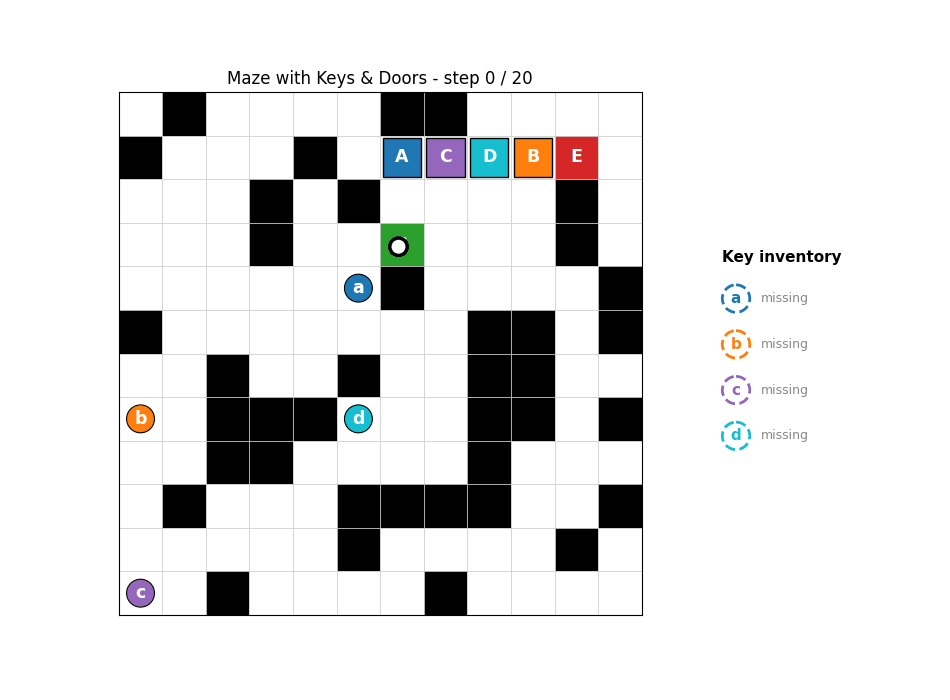

# Problem 1 - Maze with Keys and Doors

CSE Hackathon on Data Structures and Algorithms - Dept. of CSE, CMRIT, Bengaluru (14-Oct-2026)

Find the **shortest path from `S` to `E`** in an N x N grid with walls, keys (`a-f`) and doors (`A-F`).
Keys are picked up automatically and are never used up; a door can be entered only while holding its key.



| Tool | Language | Purpose |
|---|---|---|
| `maze_solver.py` | Python 3 | solver, random maze generator, CSV in/out, CLI |
| `visualize.py` | Python 3 (matplotlib) | animated visualization (GIF / window) |
| `MazeSolver.java` | Java 11+ | independent Java implementation of the same algorithm |
| `benchmark.py` | Python 3 | comparative analysis (BFS vs Dijkstra vs A\* vs the wrong "cell-only" BFS) |
| `tests/` | Python | 22 unit tests + Python-vs-Java cross-check |

---------------------------------------------------------------------------

## 1. How to run

```bash
pip install -r requirements.txt            # matplotlib + pillow (only needed for visualization)

# Option 2 - random maze, T = 4 keys/doors, animated window + GIF
echo 4 | python maze_solver.py --random 12 --seed 3 --viz --gif demo.gif

# Option 1 - read the grid from a CSV
echo 2 | python maze_solver.py --csv examples/sample_maze.csv --out solution.csv

# Fully interactive (T and option are read from stdin)
python maze_solver.py

# Java (stdin = T, arg1 = maze csv, arg2 = optional output csv)
javac MazeSolver.java && echo 4 | java MazeSolver examples/random_12x12_T4.csv solution_java.csv
#   (Java 11+ can also run it directly:  java MazeSolver.java <maze.csv> <out.csv>)

# Tests
python -m unittest discover -s tests -v
python tests/cross_check_java.py
python benchmark.py
```

* **Output 1** - a single integer on stdout (`-1` if impossible). Prompts/warnings go to stderr so stdout stays clean.
* **Output 2** - CSV with the path marked (see section 5).
* Useful flags: `--seed`, `--grid-out`, `--out`, `--png`, `--no-show`, `--verbose`.

### Note on the letter `E` (clash in the problem statement)
The statement uses `E` for the **exit** and also lists doors `A-F`, so a door `E` would be indistinguishable from the exit.
Resolution used everywhere (solver, generator, visualizer, Java): **`E` is always the exit**, and the key types are
ordered `a/A, b/B, c/C, d/D, f/F` and, for the 6th type only, **key `e` opens door `G`**.
Therefore every maze with `T <= 5` uses exactly the letters of the statement.

---------------------------------------------------------------------------

## 2. Algorithm - BFS over states `(row, col, keyMask)`

`keyMask` is a bitmask of the keys currently held (bit i = i-th key type), so there are at most 2^T <= 64 masks.

```
state  = (r, c, mask)                       start = (Sr, Sc, 0)
move   : to a 4-neighbour (nr, nc) that is not '#'
         if it is a door  -> allowed only if its bit is set in mask
         if it is a key   -> newMask = mask | bit(key)     (automatic pick-up)
goal   : any state with (r, c) == E
answer : BFS distance of the first goal state popped; parent[] gives the path
```

Every move costs exactly 1 and the graph is unweighted, so a plain queue-based BFS is enough.

### Why the mask is part of the state (and a plain `visited[r][c]` is wrong)
The same cell can be useful twice: once **without** a key and once **with** it.

```
# # # # #
# a # # #
# . # # #
S . A E #       S -> a (3 steps) -> back down -> through A -> E  = 7 steps
# # # # #
```
The corridor cell below `a` is visited on the way up (no key) and on the way back (key `a`). A cell-only BFS marks it
visited the first time and then reports **-1**. This is a unit test (`test_same_cell_different_masks_needed`) and in the
benchmark below the cell-only BFS is wrong on most mazes.

---------------------------------------------------------------------------

## 3. Correctness, optimality and complexity

**Claim 1 - the state is sufficient.** Whether a move is legal depends only on the target cell and on which keys are held.
Keys are never consumed and doors never close, so the held set is exactly "the key cells visited so far". Nothing else
about the history matters, hence `(cell, mask)` captures everything that determines the future.

**Claim 2 - walks correspond one-to-one.** By induction on walk length, every legal walk `S -> ...` in the maze maps to a
walk from `(S, 0)` in the state graph and vice-versa (the mask after each prefix is forced). So the shortest legal maze
walk equals the shortest state-graph walk to any state whose cell is `E`.

**Claim 3 - BFS is optimal.** In an unweighted graph BFS pops states in non-decreasing distance order, so the first
popped state with cell `E` has the minimum distance. If none is ever popped, no legal walk exists and the answer is -1.

**Claim 4 - termination.** The state space is finite (N^2 * 2^T) and each state is enqueued at most once (checked by `dist[]`).

| Measure | Value |
|---|---|
| Time | O(N^2 * 2^T * 4) = O(N^2 * 2^T)  (2^T <= 64, so effectively O(N^2) with constant <= 256) |
| Space | O(N^2 * 2^T) for `dist`, `parent` and the queue |
| Lower bound | Omega(N^2): the grid must be read; the extra factor 2^T <= 64 is a constant for T <= 6 |

**Why this is the best choice:** it is optimal (Claims 1-3), linear in the number of states, needs no heuristic tuning,
and the state space cannot be shrunk in general without losing correctness (section 2 shows the mask is necessary).

---------------------------------------------------------------------------

## 4. Corner cases covered (all in `tests/test_maze.py`)

| Case | Expected | Test |
|---|---|---|
| `S` adjacent to `E` | 1 | `test_start_adjacent_to_exit` |
| `E` walled off / no keys at all | -1 | `test_no_keys_plain_maze` |
| Door on the only route, key absent | -1 | `test_door_without_key_is_blocked` |
| Key lies behind its own door | -1 | `test_key_behind_its_own_door` |
| Keys needed in the wrong order | -1 | `test_wrong_order_of_keys_blocked` |
| Must walk back over visited cells to fetch a key | counts all steps | `test_must_revisit_cells_to_fetch_key` |
| Chain of keys / doors | 5 | `test_chain_of_keys` |
| Duplicate keys, unused keys, unused doors | handled | `test_extra_keys_and_duplicate_keys` |
| Shortcut via key is better than detour | 6 | `test_key_shortcut_beats_detour` |
| Detour is better than fetching a far key | 12 | `test_detour_beats_fetching_far_key` |
| Same cell needed with two different key sets | 7 | `test_same_cell_different_masks_needed` |
| Exit `E` vs door `E` clash, key `e` / door `G` | handled | `test_e_is_exit_and_key_e_opens_G` |
| All 6 key types in one maze | handled | `test_all_six_types` |
| Non-square grid, missing/duplicate `S` or `E`, bad character, T out of range | clear error | `Validation` tests |
| Letters beyond T in the CSV | warning | `test_warning_for_letters_beyond_T` |
| CSV with BOM, blank lines, spaces | handled | `load_grid_csv` |
| Random generator: exactly T keys + T doors, always solvable, reproducible by seed | verified | `Generator` tests |
| BFS == Dijkstra == A\* on 300 random grids (incl. garbage grids) | equal | `CrossCheck` |
| Returned path is a legal walk (adjacent steps, no wall, door only with key) of the reported length | verified | `test_returned_path_is_a_legal_walk...` |
| Python and Java give the same length and identical CSV | verified | `tests/cross_check_java.py` |

---------------------------------------------------------------------------

## 5. Output CSV format

The path is marked with `x`; keys and doors on the path stay identifiable by keeping their letter after the `x`:

| Original cell | In the solution CSV |
|---|---|
| `.` on the path | `x` |
| key `a` on the path | `xa` |
| door `A` on the path | `xA` |
| `S`, `E`, walls, cells off the path | unchanged |

Example (`examples/sample_solution.csv`, length 14):
```
S,x,x,#,.,.,.,.
.,#,x,#,.,#,#,.
.,#,xa,x,x,x,#,.
.,#,#,#,#,xA,#,.
.,.,.,b,#,x,#,.
#,#,#,#,#,x,x,x
.,.,.,B,.,.,#,x
.,#,.,#,.,#,#,E
```
When the optimal walk revisits a cell (to fetch a key and come back) the CSV shows the cell once; the exact order is shown
in the animation. If several shortest paths exist, the solver returns the one BFS discovers first (deterministic).

---------------------------------------------------------------------------

## 6. Comparative analysis

| Approach | Correct? | Time | Verdict |
|---|---|---|---|
| DFS / backtracking | finds *a* path, not the shortest unless all paths are explored | exponential | rejected |
| BFS on cells only (`visited[r][c]`) | **No** - fails whenever a cell is needed with two key sets | O(N^2) | rejected (wrong) |
| **BFS on (cell, mask)** | **Yes, optimal** | **O(N^2 * 2^T)** | **chosen** |
| Dijkstra on (cell, mask) | Yes | O(N^2 * 2^T * log) | same answer, needless heap overhead: all edges cost 1 |
| A\* with Manhattan heuristic | Yes (heuristic is admissible and consistent) | same worst case, far fewer expansions in practice | good alternative, but more code and a heap |
| Try every order of keys (T! orders) with BFS between waypoints | Yes but wasteful | O(T! * T * N^2): roughly 60x more work than the mask BFS for T = 6 | rejected |
| Iterative deepening DFS | Yes | exponential, repeated work | rejected |
| Bidirectional BFS | awkward - door legality depends on keys collected *earlier* on the path, so a backward search has no well-defined mask | - | not applicable |

Measured with `python benchmark.py` (expanded = number of states popped, ms = Python wall time; seeds fixed, so it is reproducible):

```
   N  T | answer |     BFS exp / ms |  Dijkstra exp / ms |    A* exp / ms | naive(wrong)
   8  2 |     19 |      142/   0.2 |       144/    1.1 |     93/   0.1 | -1  <-- WRONG
   8  2 |     19 |       99/   0.1 |        99/    0.2 |     77/   0.1 | -1  <-- WRONG
   8  2 |     11 |       77/   0.1 |        83/    0.3 |     34/   0.1 | 13  <-- WRONG
  12  3 |     21 |      291/   0.5 |       269/    0.7 |     81/   0.2 | 23  <-- WRONG
  12  3 |     10 |       24/   0.1 |        25/    0.0 |     18/   0.0 | 10
  12  3 |     30 |      582/   0.6 |       614/    0.9 |    342/   0.5 | -1  <-- WRONG
  20  4 |     34 |     2964/   4.1 |      3071/    5.1 |    569/   1.0 | 34
  20  4 |     19 |      737/   0.9 |       733/    1.1 |    131/   0.2 | 27  <-- WRONG
  20  4 |     27 |      871/   1.0 |       893/    1.3 |    287/   0.5 | -1  <-- WRONG
  30  5 |     73 |     8160/  11.2 |      8327/   13.8 |   3125/   5.2 | -1  <-- WRONG
  30  5 |     45 |     4636/   5.1 |      4743/    7.5 |    884/   1.5 | -1  <-- WRONG
  30  5 |     25 |      812/   1.2 |       796/    1.3 |    123/   0.2 | 25
  40  6 |     33 |     1794/   4.9 |      1804/    5.3 |    211/   0.7 | -1  <-- WRONG
  40  6 |     51 |     5083/  12.0 |      5083/   15.8 |    506/   1.7 | 63  <-- WRONG
  40  6 |     23 |      354/   1.0 |       317/    0.5 |     66/   0.1 | 23

BFS == Dijkstra == A* on every maze; naive visited[r][c] BFS was wrong on 11 of 15 mazes.
```

Take-aways: BFS, Dijkstra and A\* always return the same length (also asserted in the tests); A\* expands far fewer states;
the cell-only BFS is wrong on most of these mazes (it answers -1 or a too-long path), which empirically confirms the need for the mask.

---------------------------------------------------------------------------

## 7. Visualization (`visualize.py`)

* White = open, black = wall, green = `S`, red = `E`; every key/door pair has its own colour
  (a blue, b orange, c purple, d cyan, f pink, e brown); keys are coloured circles with their letter, doors are coloured squares.
* The path walked so far is highlighted (yellow cells + orange line) and a white marker shows the current position.
* **Key pick-up:** the key disappears and the **Key inventory** panel on the right switches that key from "missing" (dashed) to "collected" (filled).
* **Door opening:** the door turns from its colour to white (dashed outline in its colour) and shows an open padlock.
* Export: `--gif demo.gif`, `--png final.png`, or a live window with `--viz`.

Other tools allowed by the rules (VisuAlgo, Python Tutor) can be used to explain plain BFS; this project animates the
key/door extension specifically.

---------------------------------------------------------------------------

## 8. Project layout

```
maze_solver.py        solver + generator + CLI
visualize.py          matplotlib animation
MazeSolver.java       Java implementation
benchmark.py          BFS / Dijkstra / A* / wrong-BFS comparison
tests/test_maze.py    22 unit tests
tests/cross_check_java.py
examples/             sample + random mazes, their solutions, demo.gif, final_frame.png
requirements.txt
```

Team: Muskan Jaiswal - 1CR24CS109 
